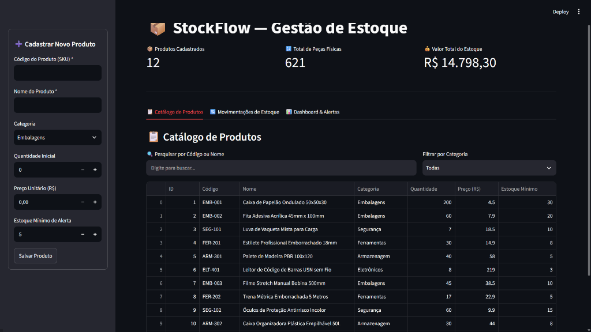
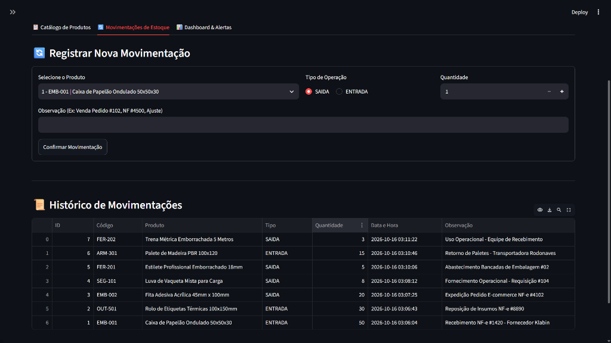
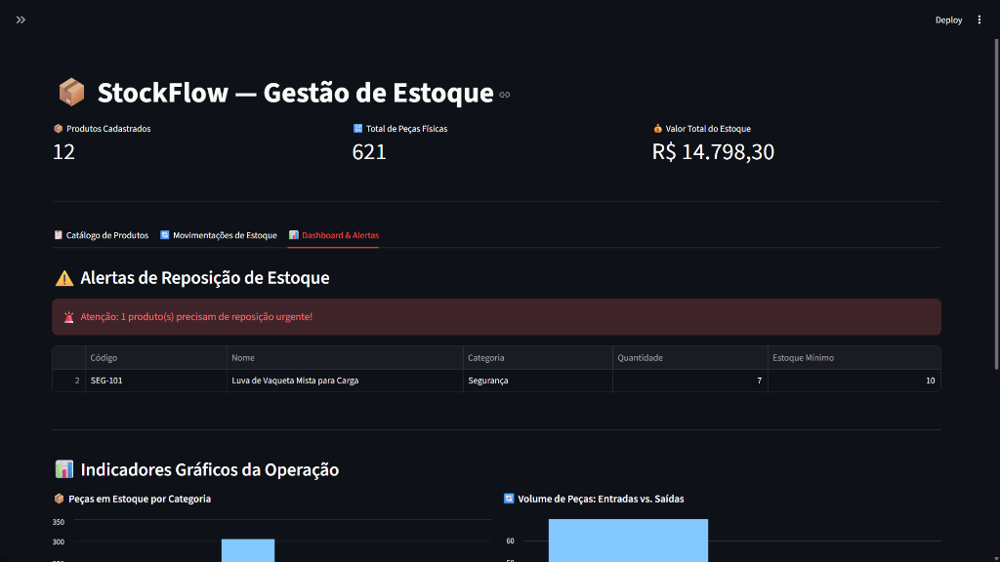
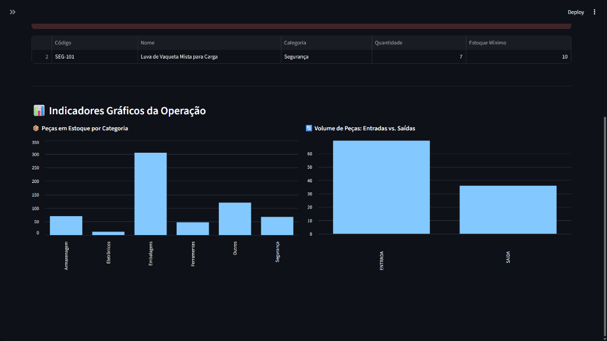

# 📦 StockFlow — Inteligência Operacional para Gestão de Estoque

O **StockFlow** é uma aplicação desenvolvida para resolver problemas reais de controle de estoque, expedição e logística em pequenas e médias operações. 

O sistema oferece controle físico e financeiro, rastreabilidade de entradas e saídas, validação de regras de negócio contra saldo negativo e alertas visuais de reposição para evitar rupturas de estoque.

---

## 📸 Demonstração Visual do Sistema

### 1. Catálogo de Produtos e Indicadores Executivos (KPIs)
Visão geral com indicadores financeiros e físicos em tempo real, formulário de cadastro com validação na barra lateral e busca inteligente:


---

### 2. Registro Operacional e Histórico de Movimentações
Lançamento de Entradas e Saídas com justificativa, validação de saldo físico e histórico cronológico consultado via SQL `JOIN`:


---

### 3. Inteligência Operacional: Alertas de Reposição e Gráficos
Identificação automática de itens críticos abaixo do estoque mínimo de segurança e gráficos de distribuição por categoria e fluxo de peças:




---

## 🚀 Principais Funcionalidades

- **Gestão de Produtos:** Cadastro detalhado (Código/SKU, Nome, Categoria, Preço, Estoque Inicial e Estoque Mínimo de Alerta) com validação de código único.
- **Catálogo Interativo:** Visualização em tabela com busca inteligente por múltiplas palavras (SKU e Nome) e filtro dinâmico por Categoria.
- **Movimentações Operacionais (Entradas e Saídas):** Registro de chegadas de fornecedor e saídas para expedição com justificativa/observação (ex: Número de NF, Pedido).
- **🛡️ Trava de Segurança Contra Estoque Negativo:** O sistema impede operações de saída com quantidades superiores ao saldo físico disponível.
- **Histórico com SQL JOIN:** Rastreabilidade cronológica completa cruzando as movimentações com os dados dos produtos via banco relacional.
- **⚠️ Alertas Automáticos de Reposição:** Identificação imediata e destaque visual para produtos que atingiram ou estão abaixo do estoque mínimo.
- **📊 Indicadores e Gráficos Gerenciais:** KPIs executivos em tempo real (Total de SKUs, Peças Físicas e Valor Total em Estoque em R$), acompanhados de gráficos de distribuição por categoria e volume de operações.

---

## 🛠️ Tecnologias Utilizadas

- **Python 3.12+**
- **SQLite3:** Banco de dados relacional com integridade referencial (`FOREIGN KEY`) e consultas parametrizadas contra *SQL Injection*.
- **Streamlit:** Interface web moderna, responsiva e interativa.
- **Pandas:** Manipulação, agregação (`groupby`) e filtros de dados tabulares.
- **Git & GitHub:** Controle de versão profissional com commits semânticos por etapa de desenvolvimento.

---

## 📂 Arquitetura do Projeto

- `app.py`: Interface visual, formulários, abas e dashboards (Streamlit).
- `database.py`: Camada de banco de dados, conexão SQLite e regras de negócio.
- `requirements.txt`: Lista de dependências do projeto.
- `.gitignore`: Configuração de arquivos ignorados pelo Git.
- `assets/`: Imagens e capturas de tela da aplicação em funcionamento.
- `README.md`: Documentação oficial do projeto.

---

## ⚙️ Como Executar o Projeto Localmente

1. **Clone o repositório:**
   ```bash
   git clone https://github.com/codes-by-matheus/stockflow.git
   ```

2. **Acesse a pasta do projeto:**
   ```bash
   cd stockflow
   ```

3. **Crie e ative o ambiente virtual:**
   ```powershell
   python -m venv .venv
   .\.venv\Scripts\Activate.ps1
   ```

4. **Instale as dependências:**
   ```bash
   pip install -r requirements.txt
   ```

5. **Inicie a aplicação:**
   ```bash
   streamlit run app.py
   ```

---

## 👨‍💻 Autor

Desenvolvido por **Matheus da Silva**  
- GitHub: [codes-by-matheus](https://github.com/codes-by-matheus)
